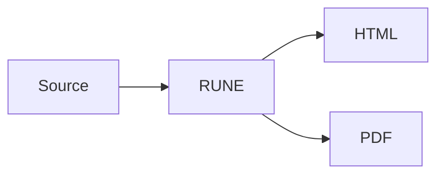

# Markdown rendering

| Input | Output |
|---|---|
| Markdown | HTML |
| HTML | PDF |



```reactflow
{
  "title": "RUNE flow",
  "nodes": [
    {"id":"source","position":{"x":20,"y":100},"data":{"label":"Source"}},
    {"id":"rune","position":{"x":300,"y":100},"data":{"label":"RUNE"}}
  ],
  "edges": [{"id":"e1","source":"source","target":"rune"}]
}
```
